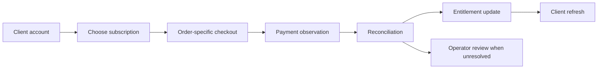
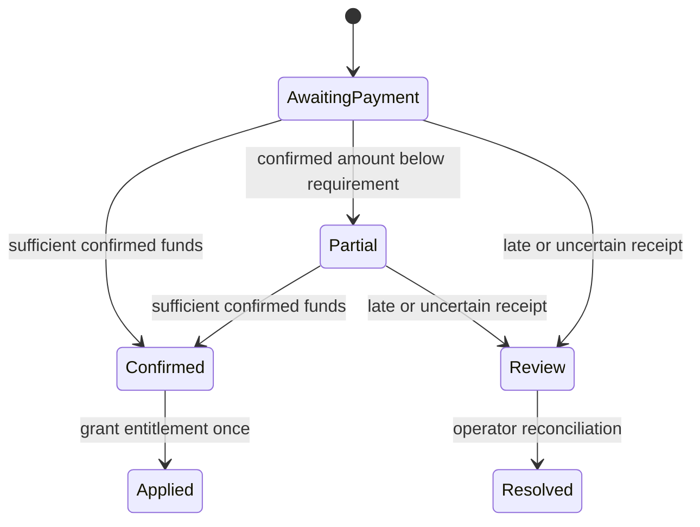

# Lifecycle and engineering decisions

These are conceptual diagrams for a public case study. They omit network topology, protocols, addresses, and private implementation details.

## User journey

The checkout status is an account state a person can understand. It must not treat an unavailable observer as proof that no money arrived.

## A simplified payment model

Names above explain the design; they are not exported production state identifiers.

## Tradeoffs

| Decision | Why it helped | Cost or boundary |
| --- | --- | --- |
| Order-specific destination | Makes attribution independent of shared payment amounts. | Address allocation, ownership, and reconciliation need operational care. |
| Exact ledger amounts | Keeps the record consistent with what was received. | Human-facing payment guidance needs separate formatting rules. |
| Idempotent entitlement application | Repeated checks do not create another subscription period. | Receipt identity and durable state must survive restarts. |
| Manual path for exceptional funds | Retains evidence when automated attribution is unsafe. | An operator must own the unresolved queue. |
| Separate new-order admission from reconciliation | Existing orders remain traceable when new capacity is unavailable. | Availability has more than one state to expose and monitor. |

## Useful acceptance questions

Can another account claim the same public receipt? Does a restart reapply a payment? What happens to a partial payment after expiry? Can existing orders still be checked when new order creation is blocked? Does renewing early preserve the remaining term?

Those questions shaped the implementation and recorded regression work. Public documentation provides no receipt corpus, private code, or independent replay of that work.
